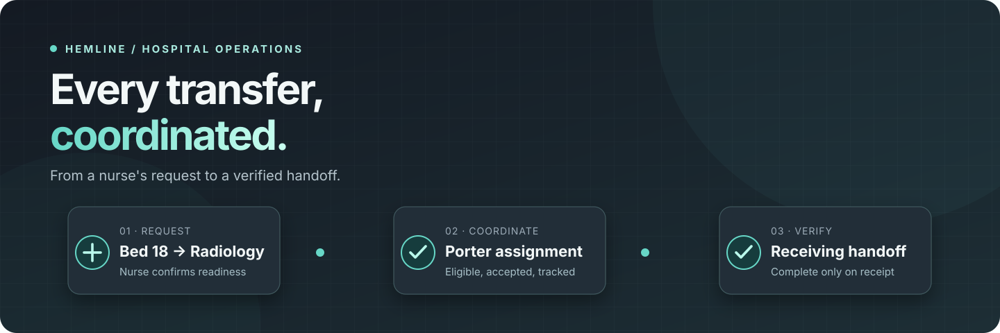
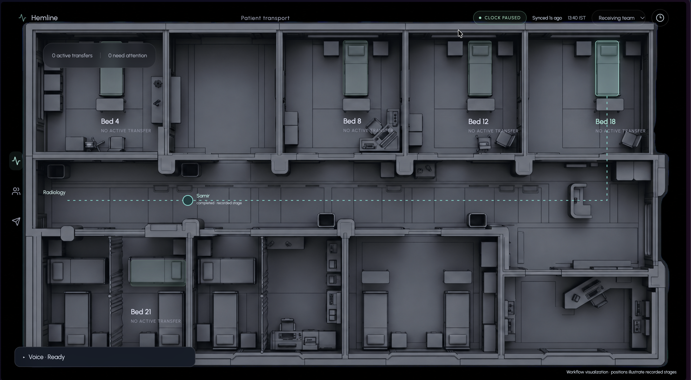
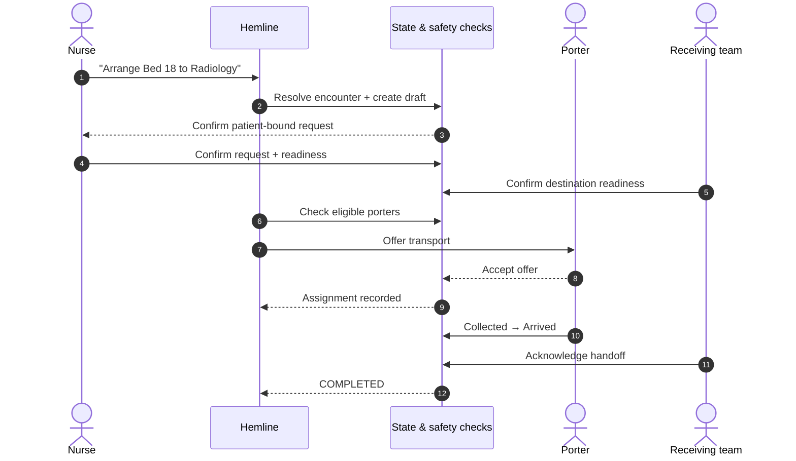
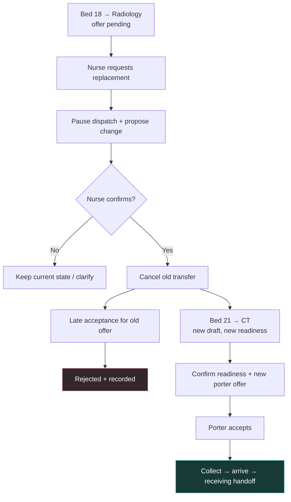
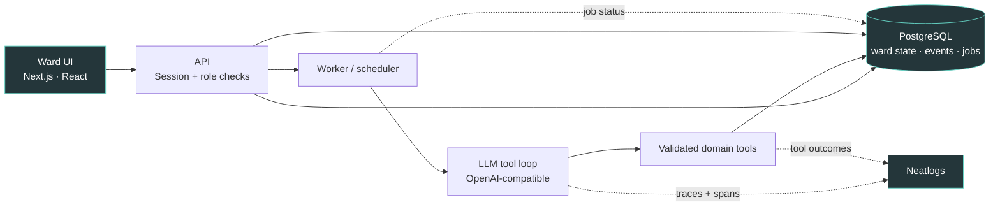

<div align="center">



<br />

**Patient transport isn't just movement. It's coordination.**

Hemline brings nurses, porters, and receiving teams into one traceable workflow — from the first request to the final, verified handoff.

<br />

[**Try the live demo →**](https://hemline-three.vercel.app/) &nbsp;·&nbsp; [Explore the code](https://github.com/gauravk16in/hemline) &nbsp;·&nbsp; [How it works](#how-hemline-works)

<br />


</div>

> [!IMPORTANT]
> **A working prototype, not a clinical system.** All patients, staff, and messages in the demo are fictional. Hemline has not been validated for real hospital deployment. **Do not enter real patient information.**

---

## The problem: a transfer can fail between the conversations

A nurse asks for a porter. The receiving department is running late. An offer goes unanswered. Somebody calls again, and somebody else assumes the patient is already on the way.

None of those is necessarily a transport problem. **They're coordination gaps.**

Hemline is an experiment in closing those gaps: it helps interpret staff messages, surfaces the next responsible action, proposes changes when plans shift, and records the evidence behind each transition.

<div align="center">
  
  <sub>The illustrated ward scene under Hemline's interactive bed overlays — not live staff-position tracking.</sub>
</div>

## How Hemline works

| | What happens | Why it matters |
|:--|:--|:--|
| **01 · Ask** | A nurse requests a transfer in everyday language. Hemline resolves the patient and prepares a draft. | No elaborate dispatch form to learn. |
| **02 · Confirm** | The nurse and receiving team provide the required readiness evidence. | A request doesn't become a dispatch just because an AI says so. |
| **03 · Coordinate** | The agent checks current porter eligibility, issues an offer, and waits for acceptance. | Staff availability and explicit acceptance stay authoritative. |
| **04 · Adapt** | A decline, cancellation, or department delay triggers a guarded recovery or a proposal for approval. | A changed plan doesn't silently become a completed action. |
| **05 · Verify** | Collection, arrival, and receiving acknowledgement are recorded. | **Completed** means a verified handoff, not merely an ETA. |

### A transfer, end to end



*This is a representative synthetic workflow. Real staff positions are not tracked.*

### When the plan changes

A good coordinator doesn't just handle the happy path.

For example, suppose a nurse starts **Bed 18 → Radiology**, then interrupts: *“Cancel that. Bed 21 needs CT instead.”* Hemline can pause the old dispatch, prepare a replacement, and request nurse confirmation. A stale acceptance from the original porter is rejected rather than reviving the cancelled transfer.



The same principle applies to a scanner delay: Hemline can interpret *“Scanner delayed 15 minutes”*, record a **pending** update, and **propose** a reschedule. **An authorized nurse still confirms the schedule change.** It isn't applied blindly.

## What makes it an agent — and what keeps it accountable

Hemline uses an OpenAI-compatible model/tool interface to interpret messy language, resolve references, choose permitted tools, ask follow-up questions, and replan after tool results.

It **doesn't** let the model decide whether a transfer is officially complete.

| Agent can… | Backend must verify… |
|---|---|
| Interpret “Bed 18 needs Radiology” | Patient identity and active transfer |
| Suggest eligible porter(s) | Readiness, capability and current availability |
| React to a late or rejected offer | Revision, offer status, cancellation guard |
| Interpret a receiving delay | Source-message ownership and confirmation |
| Narrate the outcome | Committed events and receiving acknowledgement |

**The design rule:** *The agent proposes and coordinates; the state machine enforces.*

## Under the hood



**The stack, without the buzzwords:**

- **Interface:** Next.js 16, React 19, TypeScript, an interactive ward canvas, action panels, and a transfer history.
- **Workflow engine:** explicit transfer phases, role restrictions, readiness requirements, revision checks, idempotent HTTP commands, and recovery paths in `lib/domain.ts`.
- **Agent:** tool-calling model via an OpenAI-compatible gateway; a deterministic **fixture adapter** is available for local demos.
- **Persistence:** local PGlite for development or hosted PostgreSQL (including Supabase); ward state, events, receipts, and jobs are stored durably.
- **Execution:** a worker runs pending agent jobs. Deployment options include Vercel with an external worker, a Render supervisor, or a bounded activity-driven AWS Lambda scheduler.
- **Observability:** Neatlogs captures model and tool traces to help debug what the agent actually attempted.
- **Tests:** Vitest, Playwright, and scenario scripts for interruption, stale offers, and recovery.

<details>
<summary><strong>See the core project structure</strong></summary>

```text
app/
  ward.tsx                 # Ward interface and staff interactions
  ward-canvas.tsx          # Interactive map overlays
  api/[...path]/route.ts   # API routes and command handling
lib/
  agent.ts                # Model tools and agent loop
  domain.ts               # Authoritative workflow state machine
  store.ts                # Transactions, jobs and durable storage
  security.ts             # Sessions, ownership and request checks
  worker.ts               # Background job processing
  scheduler.ts            # Bounded scheduler coordination
supabase/migrations/      # PostgreSQL schema
aws/lambda_function.py    # Optional activity-driven worker
tests/                    # Domain and integration tests
e2e/                      # Browser scenarios
scripts/                  # Local worker and reproducible tests
```

</details>

## Try it yourself

**Live:** [hemline-three.vercel.app](https://hemline-three.vercel.app/)

In the demo, open a sandbox and try:

> **Arrange transport for the patient in Bed 18 to Radiology.**

Then switch between **Nurse**, **Receiving team**, and **Porter** to provide the required confirmations. You can track the transfer and its recorded activity on the ward board. Use **guided playback** for labelled simulated staff replies, or **manual** mode to control each action.

For a second scenario, try **Bed 21 → CT**. The clock and staff-response controls are intentionally simulated; the map does not track people in real time. Browser dictation is optional, with text input as the fallback.

## Run locally

**Requirements:** Node.js **22**, npm.

```bash
git clone https://github.com/gauravk16in/hemline.git
cd hemline
npm ci
cp .env.example .env.local
npm run dev
```

In another terminal:

```bash
npm run worker:dev
```

Visit **http://127.0.0.1:3000**.

The default local setup uses an embedded PostgreSQL-compatible **PGlite** database and, without `OPENAI_API_KEY`, an explicit deterministic **fixture adapter**. That makes it possible to explore the workflow without spending on model calls. The fixture is **not** a real LLM.

<details>
<summary><strong>Enable the real agent, tracing, or hosted database</strong></summary>

Edit `.env.local`, using `.env.example` as the authoritative template:

```dotenv
# Hosted PostgreSQL (optional locally)
DATABASE_URL=

# OpenAI-compatible provider / gateway
OPENAI_API_KEY=
OPENAI_BASE_URL=
OPENAI_MODEL=
MODEL_API=chat

# Model/tool tracing (optional for local fixture use)
NEATLOGS_API_KEY=

# Production deployments also require session/worker secrets
SESSION_SECRET=
WORKER_SECRET=
```

A real model call needs valid provider credentials and sufficient budget. Hosted public sandboxes additionally require the configured authentication and Turnstile protections. **Never commit `.env.local` or credentials.**

See [`.env.example`](.env.example), [Vercel configuration](vercel.json), and [worker blueprint](render-worker.yaml) for available configuration.

</details>

### Tests & verification

```bash
npm run typecheck
npm run lint
npm test
npm run test:integration
npx playwright install chromium
npm run test:e2e
npm run build
```

With a real model and Neatlogs configured, `npm run provider:smoke` and `npm run eval` exercise provider-specific paths. Test against **isolated synthetic data**, never real patient records or a public production database.

## A bug that made observability matter

In a preserved receiving-delay test, the agent passed the **wrong source-message ID** to a tool. The backend correctly rejected the call, but the model's reply incorrectly claimed the delay was recorded.

The trace made the mismatch visible: **what the model said ≠ what the system committed.**

The agent instructions were updated to use the authorized message ID and recover after a rejection. Three matched targeted reruns then recorded the pending destination delay, proposed a reschedule, and waited for nurse confirmation.

This is **targeted evidence of a repaired path**, not a claim that all model behavior or deployment scenarios have been verified.

## Current scope

**Implemented in the prototype:** patient-bound transfer requests; readiness and receiving confirmations; porter offers and acceptance; cancellation/replacement workflows; delay proposals; explicit receiving handoffs; per-transfer history; role-specific actions; simulated playback; persisted state and agent traces.

**Not established:** real-hospital clinical validation, live location tracking, measured time/cost savings, universal speech-recognition support, or comprehensive production reliability. A hosted page loading alone does not prove the worker is healthy.

Hemline is designed to support people performing hospital operations — **not** to make autonomous clinical decisions.

Released under the [MIT License](LICENSE). Contributions and thoughtful feedback are welcome through [GitHub Issues](https://github.com/gauravk16in/hemline/issues).


